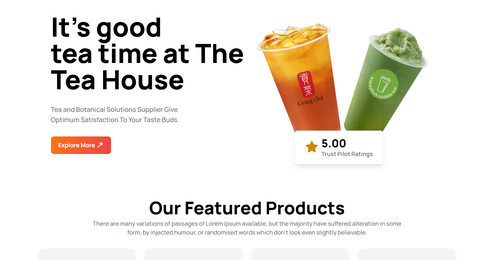

# 🍵 CHA MOY — The Tea House

A modern, fully responsive tea shop landing page built with **HTML** and **Tailwind CSS**. ☕✨

---

## 📸 Preview



---

## 🚀 Live Demo

🔗 [View Live Site](#) *(https://iseyamin.github.io/cha-moy/)*

---

## ✨ Features

- 📱 **Fully Responsive**: works on mobile, tablet, and desktop
- 🎨 **Modern UI**: orange-to-red gradients, soft shadows, rounded cards
- 🔤 **Custom Typography**: Google Font *Manrope*
- ⭐ **Rating Card**: Trust Pilot style rating overlay on the hero image
- 🛍️ **Featured Products Grid**: 4 tea varieties in a responsive grid
- 💬 **Client Reviews Section**: layered testimonial cards
- 📰 **News & Events Cards**: latest updates at a glance
- 📧 **Newsletter Footer**: email subscription input and social links

---

## 🧩 Page Sections

| Section | Description |
|---|---|
| 🏠 **Header / Hero** | Headline, tagline, CTA button, banner image, rating card |
| 🫖 **Featured Products** | Milk Tea, Black Tea, Lemon Tea, Green Tea |
| 🌿 **Great Tea, Freshly Presented** | Brand story with image grid |
| 🗣️ **Meet Our Super Clients** | Customer testimonials |
| 📰 **News & Events** | Blog/news cards |
| 🔻 **Footer** | Quick links, services, help, newsletter, social icons |

---

## 🛠️ Built With

- 🌐 **HTML5**
- 🎨 **[Tailwind CSS](https://tailwindcss.com/)** (via CDN)
- 🔠 **[Google Fonts](https://fonts.google.com/)**: Manrope
- 🎯 **[Font Awesome](https://fontawesome.com/)**: icons

---

## 📁 Project Structure

```
📦 cha-moy
 ┣ 📂 images
 ┃ ┣ 🖼️ banner.png
 ┃ ┣ 🖼️ tea-1.png … tea-4.png
 ┃ ┣ 🖼️ fresh-1.png, fresh-2.png
 ┃ ┣ 🖼️ client.png
 ┃ ┣ 🖼️ news-1.png … news-3.png
 ┃ ┗ 🖼️ cup.png
 ┣ 📄 index.html
 ┗ 📄 README.md
```

---

## ⚙️ Getting Started

1. 📥 **Clone the repository**
```bash
   git clone https://github.com/iseyamin/cha-moy.git
```
2. 📂 **Open the folder**
```bash
   cd cha-moy
```
3. ▶️ **Run the project**
   Open `index.html` in your browser. No build step needed! 🎉

> 🌍 An internet connection is required, since Tailwind, Google Fonts, and Font Awesome load from CDNs.

---

## 🎨 Customization

Tailwind is configured inline in the `<head>`:

```js
tailwind.config = {
  theme: {
    extend: {
      colors: {
        clifford: '#da373d',
      }
    }
  }
}
```

Add your own brand colors here. 🖌️

---

## 🔮 Future Improvements

- [ ] 🛒 Add shopping cart functionality
- [ ] 🌙 Dark mode
- [ ] 🧭 Mobile navigation menu
- [ ] 🎞️ Scroll animations
- [ ] ✅ Working newsletter form

---

## 🤝 Contributing

Contributions, issues, and feature requests are welcome! 💡
Feel free to fork the repo and open a pull request.

---

## 👨‍💻 Author

**IS Eyamin**

- 🐙 GitHub: [@iseyamin](https://github.com/iseyamin)
- 📘 Facebook: [is.eyamin.31](https://www.facebook.com/is.eyamin.31)
- 📸 Instagram: [@is_eyamin_official](https://www.instagram.com/is_eyamin_official/)

---

## 📜 License

This project is open source and available under the [MIT License](LICENSE).

---

<p align="center">Made with ❤️ and 🍵 by IS Eyamin</p>****
